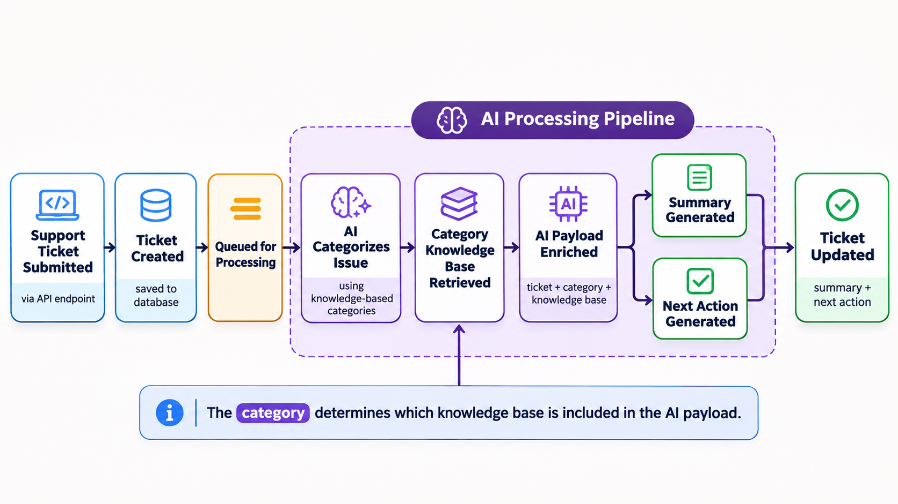

# Support Dashboard

A full-stack customer-support workspace built with Laravel, React, and Inertia. It combines issue management, team comments, token-authenticated APIs, and queued AI assistance grounded in a curated enterprise-hardware knowledge base.

[](https://laravel.com/)
[](https://react.dev/)
[](https://inertiajs.com/)
[](https://pestphp.com/)
[](https://opensource.org/licenses/MIT)

## What it demonstrates

- A practical support workflow for creating, filtering, reviewing, updating, and resolving customer issues.
- Authenticated browser sessions and Laravel Sanctum personal-access tokens for API clients.
- Team comments tied to the authenticated support agent rather than trusting a submitted author name.
- Queued AI summaries and suggested next actions grounded only in the supplied knowledge base.
- A deterministic local fallback, so the workflow remains usable without an OpenAI API key.
- Automatic attention flags for high-priority issues and clear summary-processing states.
- Idempotent seeders with realistic sample issues, comments, users, and hardware-support knowledge.
- Feature tests covering validation, filters, relationships, queued jobs, query counts, and bearer-token authentication.

## Technology

| Area | Tools |
| --- | --- |
| Backend | PHP 8.2+, Laravel 12, Eloquent, queues |
| Frontend | React 18, Inertia.js 2, Tailwind CSS, Vite |
| Authentication | Laravel Breeze and Sanctum |
| AI workflow | OpenAI Responses API with structured output and a local fallback |
| Data | SQLite for zero-service local setup; MySQL-compatible schema |
| Testing | Pest and Laravel feature tests |

## How the AI workflow stays reliable

The summary job first classifies an issue and retrieves matching articles from the seeded knowledge base. The model is instructed to use only that supplied context and return a concise summary plus one concrete next action. If the API is unavailable or no key is configured, the same job produces a deterministic knowledge-based response instead of leaving the issue incomplete.



The classification step uses the submitted category and knowledge-base keyword matching. The selected category determines which knowledge-base articles are included in the AI payload; the summary and suggested next action are then returned together in one structured response.

## Setup and run

Requirements: PHP 8.2+, Composer, Node.js/npm, and the PHP SQLite extension. SQLite is the default because its zero-service setup makes local assessment reproducible; the schema also supports MySQL deployments.

```bash
git clone https://github.com/mathewoc555/support-dashboard.git
cd support-dashboard
composer install
cp .env.example .env
php -r "file_exists('database/database.sqlite') || touch('database/database.sqlite');"
php artisan key:generate
npm install
php artisan migrate --seed
composer run dev
```

On Windows Command Prompt, use `copy .env.example .env` instead of `cp`.

After seeding, sign in with the default local administrator:

```text
Email: admin@example.com
Password: Password123
```

Change this seeded password before using the application outside a local or assessment environment.

Update the database settings in `.env`. The default uses SQLite. For MySQL, use:

```env
DB_CONNECTION=mysql
DB_HOST=127.0.0.1
DB_PORT=3306
DB_DATABASE=support_dashboard
DB_USERNAME=root
DB_PASSWORD=
```

Create an OpenAI API key at [platform.openai.com/api-keys](https://platform.openai.com/api-keys), then add it to `.env`:

```env
OPENAI_API_KEY=your-key
OPENAI_MODEL=gpt-6-luna
```

Do not commit or share the key. Without a key, queued summaries use the local knowledge-base fallback.

## Database

Create/update and seed the database:

```bash
php artisan migrate --seed
```

Rebuild it from scratch:

```bash
php artisan migrate:fresh --seed
```

Run the summary queue worker manually when needed:

```bash
php artisan queue:work
```

For deployments where a persistent Supervisor-managed worker is unavailable, `worker.php` provides a cron-friendly alternative. It safely processes the waiting jobs and exits when the queue is empty. Add this cron entry to run it every minute:

```cron
* * * * * cd /var/www/support-dashboard && /usr/bin/php worker.php >> storage/logs/worker-cron.log 2>&1
```

Replace `/var/www/support-dashboard` and `/usr/bin/php` with the paths used by your server. Test the command before enabling cron:

```bash
php worker.php
```

## API

Create a personal access token at `/dashboard/api`, then use it as a Bearer token.

```bash
curl -X POST "http://localhost:8000/api/issues" \
  -H "Accept: application/json" \
  -H "Content-Type: application/json" \
  -H "Authorization: Bearer YOUR_TOKEN" \
  -d '{
    "customer_name": "Acme Ltd",
    "title": "Drive compatibility check",
    "description": "Will this SAS drive work with our controller?",
    "priority": "high",
    "category": "Technical Issues"
  }'
```

Main endpoints:

```text
GET    /api/issues
POST   /api/issues
GET    /api/issues/{id}
PATCH  /api/issues/{id}
DELETE /api/issues/{id}
POST   /api/issues/{id}/comments
```

Run automated tests:

```bash
php artisan test
```

## Architecture & decisions

- Sanctum supports both browser sessions and personal access tokens.
- Issues and comments use a one-to-many relationship.
- `GenerateIssueSummary` classifies the issue, retrieves matching seeded knowledge, then generates the summary and next action through OpenAI or the local fallback.
- High-priority issues set `needs_attention=true`; it is recomputed on creation and priority changes.
- API validation trims input and returns standard `422` field errors.
- Seeders are idempotent and add the admin, knowledge base, and sample issues/comments without clearing existing rows.

## AI usage

- OpenAI Codex was used to scaffold and refine migrations, API controllers, React pages, tests, and documentation.
- OpenAI image generation was used for the favicon.
- Generated work was reviewed for validation, authentication, relationships, queue behavior, cleanup, error handling, and test coverage.
- The initial generic summary logic was changed to use seeded enterprise-hardware knowledge, structured OpenAI output, and a deterministic fallback.

## Roadmap

- Add Laravel Reverb/WebSockets or Pusher so completed summaries and suggested next actions appear in the dashboard immediately without refreshing the page.
- Add issue assignment and assignment-history tables for ownership, handoffs, and a reliable audit trail.
